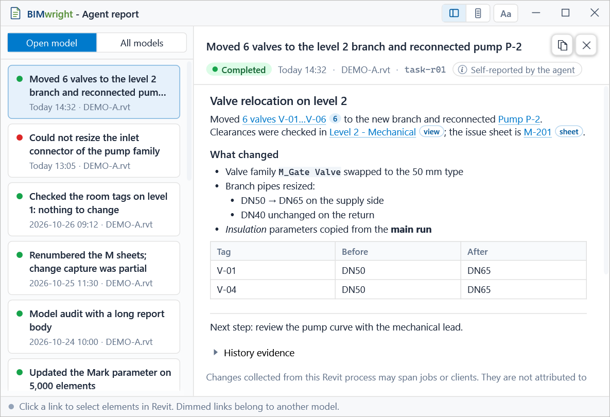
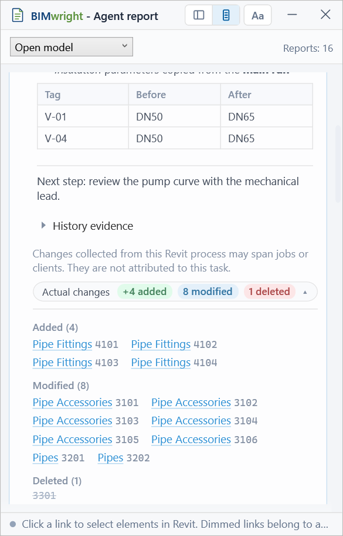

# Agent reports

`revit_report_task_result` lets an agent leave one report for the Revit user when a
job is finished. The add-in stores the report on the user's machine, shows an
"Agent sent a report" toast and lists the report in the **Reports** window (ribbon
button stacked above Settings beside the MCP / History / Toast group). Links in the report select elements or open views in Revit.

The tool is in the `meta` toolset, so it is on by default. It does not change the
model and stays available with `--read-only`, because it only writes per-user report
data. It needs a gateway and Revit add-in that both support `agent_reports_v1`. An
older add-in returns `AGENT_REPORTS_CAPABILITY_REQUIRED`: update the gateway and the
add-in together from the same Setup release.

## When to call

Call it once for a job that worked in Revit: one that changed elements, or one that
found elements the user should check. Call it after you have verified the whole result,
or when the job failed or was cancelled after changing the model. Do not call it for a
quick answer in chat, for a job that stopped before changing anything, or after each
tool. A report is the agent's own account: the window labels it "Self-reported by the
agent" and shows next to it the changes rvt-mcp actually recorded.

The server reminds the agent, because a client that loads tool descriptions on demand
may never read this tool's:

- The server instructions say when to report.
- Until a report is sent, every tool response that changed the model carries `_report`:
  the first in full, the rest as a short line.
- The first answer from a check tool in a job (for example `revit_find_untagged_elements`,
  `revit_clash_detection` or `revit_get_model_warnings_summary`) carries `_report` asking
  for a report if the check found elements to look at.
- A sent report starts the next job. `_report` appears only when the connected add-in
  supports reports and the `meta` toolset is enabled.

- Use one `task_id` per job. Sending the same `task_id` again from the same client session to the same Revit
  process replaces that report. Different client sessions have separate reports. Use this to fix links the response lists as
  unresolved.
- `batch_execute` rejects this command; call it directly.
- A job that ran in two Revit processes sends one report to each process.

| Parameter | Rule |
|---|---|
| `task_id` | 1–80 characters, unique per job |
| `outcome` | `completed`, `failed` or `cancelled` |
| `summary` | 1–120 characters, one line; the report title in the list and the toast |
| `body` | Optional Markdown subset (below), at most 32 KiB as UTF-8 |
| `call_ids` | Optional JSON string array of at most 256 capture IDs, selected explicitly for this job on its first report |

The server checks these limits before anything is sent to Revit.

## Response

```json
{
  "report_id": "<32 hex>", "replaced": false,
  "links": { "total": 12, "resolved": 11,
    "unresolved": [ { "label": "Pipe DN50", "target": "revit:999", "reason": "element_not_found" },
                    { "label": "Level 2 branch", "target": "revit:5,6", "reason": "element_not_found", "ids": [6] } ],
    "warnings": [ { "target": "revit:123?view=5", "reason": "view_hint_invalid" } ] },
  "changes_attached": { "documents": 1, "added": 4, "modified": 8, "deleted": 0,
    "complete": true, "truncated": false, "scope": "process" },
  "provenance": { "scope": "process", "client_session": null, "calls": null },
  "toast": "shown"
}
```

- `links.total` counts every complete `[…](revit:…)` link, including ones with bad
  syntax.
- `resolved` counts links with at least one element found.
- A partly resolved link counts as resolved and also has an `unresolved` entry whose
  `ids` lists the IDs that were not found.
- `reason` is one of `bad_syntax`, `document_not_open`, `element_not_found`,
  `no_document` or `limit_exceeded`.
- An invalid `view=` hint is dropped and reported under `warnings`; the link still
  works.
- `changes_attached` is `null` when there is neither a previous capture for this task
  nor a newly completed MCP command to attach. An empty capture differs from no data.
- `scope: "calls"` means explicit selected calls; `client` means a client interval.
  `scope: "process"` means changes collected from the Revit process, possibly across
  jobs or clients. It does not attribute those changes to the report's task or client.
- `complete` describes capture health within that scope. `truncated` independently
  says whether element IDs were omitted at the 5,000-ID limit per document.
  `complete: true` can coexist with `truncated: true`; neither verifies the agent's
  account. Counts describe the attached lists, not totals before truncation.
- `provenance.calls` previews at most 10 call/model references; `total_call_references`
  and `calls_truncated` describe that response preview. The saved report retains all
  references; use `revit_get_report_history` to paginate its evidence.
- `toast` is `shown`, or `disabled` when the user has turned toasts off.

## Body format

The body is a small Markdown subset, parsed by the add-in itself:

- headings `#`, `##`, `###` followed by a space;
- paragraphs separated by a blank line; a single line break inside a paragraph is kept;
- bullet (`-`, `*`) and numbered (`1.`) lists, nested one level by indenting two or
  more spaces;
- `**bold**`, `*italic*`, `` `code` `` and fenced code blocks, shown verbatim;
- pipe tables with a separator row (`|---|---|`);
- a line of three or more `-` as a rule.

`_` is always a literal character. A backslash escapes `` \ ` * _ [ ] ( ) | # - ``.
HTML, images, block quotes and autolinks show as plain text. Links to anything other
than `revit:` show their label as plain text and do not open a browser.

## Links

```
[label](revit:<id>[,<id>...][?view=<viewId>][&doc=<document_id>])
```

- **Without `doc`,** the link targets the document that was active when the report
  arrived.
- **For another open document,** add `doc=<_target.document_id>`. Use `?doc=` when
  there is no view parameter.
- **`view=`** is a hint: the view to try first when the user clicks.
- **A link to a view or sheet** needs no special syntax. The add-in recognizes it,
  and a click opens that view.
- **Labels and targets:**
  - the label must not be empty and must fit on one line;
  - the target has no spaces;
  - `view` and `doc` may each appear once.
  - A bare `revit:123` without the bracket form is plain text.
- **Limits:** 300 links per report, 500 IDs per link and 2,000 IDs per report.
  - They are counted in body order, over well-formed links only.
  - A link past a limit is `limit_exceeded`.

When the report arrives, the add-in looks up every ID and stores the element's unique
ID, category and name. A link with no element found shows its label as plain text, so
the user never sees a broken link. The response tells you which links to fix.

## What the user sees

 

*Synthetic test data, rendered by `tests/RvtMcp.Reports.Tests -- --snapshot`.*

The Reports window has two modes, switched in its title bar:
- **Wide:** the report list on the left, the selected report on the right;
- **Compact:** one column of cards.

Compact groups cards by their creation date in the machine's local time zone, newest
day first. A day separator shows Today, Yesterday or a date in the UI language, with
the count after the current model filter. Unknown timestamps go in an Unknown date
group at the end. Separators are not reports or actions; cards show `HH:mm`, with the
full timestamp, UTC offset and time-zone ID in a tooltip.

An updated report stays in its original creation-day group and shows an Updated
timestamp. Date labels refresh when the window is activated or reloaded, and within
one minute of midnight while Compact is visible. Changing the OS time zone also
regroups the feed; dates are never inferred from file names.

Refreshing Compact preserves the visible card and reading position. A new report
does not open itself or pull the reader to the top. When reading farther down, a
New reports button counts newly arrived reports in the current filter; clicking it
goes to the top without opening a different card. At the top, arrivals appear normally.
The same reading position is restored after watcher updates while the window is hidden.
If the anchored report disappears, the feed uses the nearest surviving report.

Both modes:
- filter reports to the open model (default) or show all models;
- show the report body, then "Actual changes recorded by rvt-mcp";
- let the user copy or delete a report.

Table-heavy reports have collapsible sections at `##` headings; the first two sections
start open. Long tables show 25 data rows per page, with Previous / Next and a row
count. Section and page choices stay when switching between Wide and Compact or
refreshing an unchanged report. Copy includes the whole report, including closed
sections and other table pages.

An update with the same body retains its section and table-page choices. A changed
body starts fresh section/page state, because the old positions may name different
content. When an update replaces a focused control, focus falls back to that card's
header while the reading position is restored.
Wide also keeps the body scroll offset when the selected report is updated, clamped
to the new content height.

Clicking a visible link keeps the reading position. Keyboard focus on a link outside
the viewport brings that link into view. The status line shows when navigation is
waiting for Revit; opening a sheet can still take time while Revit generates its graphics.

The window remembers its mode, its size and position per mode, and its text size
(90–150 %, "Aa" button or Ctrl+Plus / Ctrl+Minus / Ctrl+0).

A link is live when its document is the active document in that Revit process, and
dimmed otherwise. The tooltip of a dimmed link names its model. A click on a live link:

1. finds the elements by unique ID, never by element ID, because another copy of the
   model can reuse IDs for other elements;
2. opens the view or sheet, for a view or sheet link;
3. for elements, picks a view that shows them, in this order:
   - the `view=` hint;
   - the active view;
   - the open views;
   - closed plans, and then `{3D}`, chosen by the add-in within about two seconds;
4. selects the elements and zooms to the ones visible in that view.

A click never opens a transaction or shows a Revit dialog. When nothing matches, the
status line explains why and the active view and selection stay as they were.

## Recorded changes

After every native MCP command, the add-in captures changes with a gateway-issued
call ID and client session, even when Change History recording is disabled.
`report_task_result` itself does not add a capture. A normal response contains
`_report_capture` (`call_id`, `client_session`, `status`). Wrappers that issue several
native calls also return `_report_captures`. If response limits omit receipts,
`_report_captures_truncated: true` means the returned IDs do not cover the whole call.
Collect IDs before reporting; do not infer them from titles, times, element IDs or
arbitrary tool data. A `failed` or `expired` receipt cannot be claimed as captured.

- Supply `call_ids` on the first report to select this job's exact captures. This uses
  `scope: "calls"`. Interleaved jobs on the same client can claim disjoint ID sets.
  Selected calls are ordered by native execution sequence, independent of array order.
- Without `call_ids`, a new gateway claims only its own client's pending interval
  (`scope: "client"`). This isolates clients but does not identify interleaved jobs.
- An older gateway without capture metadata retains the legacy process interval
  (`scope: "process"`), which may include other clients/jobs. Old reports missing
  `scope` still mean `process`. Both modes label the actual scope.
- Explicit selection requires add-in capability `agent_report_provenance_v1`.
  Unknown, expired, already assigned or foreign-client IDs fail before any selected
  capture is consumed. An interval report cannot later be relabelled as explicit.
- A resend of an explicit report may omit `call_ids` to retain its evidence without
  claiming unrelated calls. To append calls, include their IDs; already owned IDs
  are accepted. Older unclaimed calls cannot be appended after newer captures,
  because that would change net-change ordering; report those calls separately.
- Pending capture storage is bounded to 512 calls / 50,000 element entries. Eviction
  makes explicit IDs unavailable; the next client interval is incomplete and
  truncated. A report retains at most 1,024 call/model references; exceeding that
  limit fails before claiming the new calls. Unsaved captures are process-local.
- Add then modify counts as added; add then delete disappears.
- Deleted elements keep only their ID.
- Resending the same `task_id` in the same client session and running add-in keeps the report's existing
  `report_id` and creation time, restores its saved changes and merges newly claimed
  changes with the same net-change rules, even after another task reported.
- JSON is the checkpoint after a successful atomic save. Only document metadata is
  retained in memory for Undo/Redo invalidation; full element lists are released.
- Failed submissions keep their claimed changes in memory under that task ID, so
  another report cannot consume them. Retry the same `task_id` before closing Revit;
  unsaved changes do not survive a process restart.
- An unreadable, missing or corrupt prior checkpoint makes the update fail rather
  than overwrite its evidence. Restore the file and retry, or use a new task ID for
  a new report. Previously saved JSON remains unchanged on a failed write.
- Replacement is scoped to the current add-in lifetime. A different process or a
  restart creates a separate report even if the same `task_id` is reused.
- An incomplete capture, or an Undo/Redo outside MCP commands, marks the changes as
  incomplete. Undo/Redo also invalidates retained evidence for that document when
  its task is resubmitted. Other manual edits between commands are not tracked.
- The 5,000-ID limit applies to each document's combined added/modified/deleted list.
  Once IDs have been omitted, `truncated` stays true on resends. Schema-v1 reports
  written before the scope field was added are read as process-scoped.

See [change tracking](change-tracking.md) for how changes are captured.

## History evidence

Reports store exact `call_id`, `client_session`, `model_key`, tool, timestamp and
`history_requested` references alongside their captured changes (additive schema-v1
fields). They do not create a reason record or copy the SQLite history into the report.

Open **History evidence** in either mode to read a bounded page in the background.
It shows the call/model, record ID, supplied reason and recorded before/after values.
No I/O occurs while collapsed. Refresh reads newly assigned reasons. Pages and
expansion survive mode changes. Values shortened in the UI say so; missing values
say Not captured. Only some handlers/surveys supply parameter values.

`revit_get_report_history(report_id, call_offset=0, element_offset=0, call_limit=5,
element_limit=10)` reads the same local evidence without connecting to Revit.
`call_limit` is 1–10; `element_limit` is 1–25. `next_call_offset` and each call's
`next_element_offset` paginate independently; element_offset applies to every call
on the requested page. Calls are call/model references, so a multi-model command
may occupy several entries. Reason and before/after JSON are bounded to 8,192
characters each; oversized or invalid JSON is explicitly labelled with a preview.

The join requires the exact model database, call ID and session. History-off,
unresolved models, pending/missing calls, unavailable databases and legacy reports
are explicit states. Incomplete/failed calls remain labelled. History retention
and report retention are independent; deletion of either does not fabricate or
reassign evidence. A record/reason is supplied evidence, not verification that the
agent completed the whole task.

## Window chrome and reading

The idle title shows the report icon and navy/green **BIMwright - Agent report**
wordmark (localized feature name). Hover the icon/title area to reveal the owning
Revit PID and live Pipe/TCP endpoint **on the title row itself**. Moving away restores
the short caption; no title tooltip or popup is used. Both modes keep the same
32-DIP caption height, body position and keyboard focus. Hover uses smaller title
text; Compact replaces the feature label with PID/transport so those fields fit,
while Wide retains the feature label. A long endpoint is ellipsized within the
remaining title space. The taskbar title stays short and accessibility help retains
the full host details. Host changes update the hovered text; stopped/unknown clears
stale endpoints. Hide resets the hover state. Dragging, Wide double-click
maximize/restore and the title system menu are preserved.
The Reports/Settings stack uses original vector icons, tooltips and accessible
names. An optional host-ribbon adapter hides labels and enlarges those two icons;
if the host cannot support it, labelled commands remain available. MCP/History/Toast,
Language and Bake Inbox behavior is preserved.

Wide and Compact keep separate transient reading bookmarks for the current report.
Copy shows a green confirmation (or failure) at its button for 1.5 seconds. Brief
opacity effects and wheel easing honor Windows client-area animation preferences;
reduced motion scrolls immediately and does not animate layout heights.

## Storage and privacy

- **Location:** `%LOCALAPPDATA%\Bimwright\rvt-mcp\reports\`, one JSON file per
  report. Every Revit process reads the folder, so a report written by one process
  shows in the others.
- **Window:** shows the newest 500 reports.
- **Retention:** reports are deleted after 30 days, when the add-in starts. Change this
  with `reportRetentionDays` (1–3650) in `rvtmcp.config.json`. Age is the only reason
  for automatic deletion; the user can also delete a report from the window.
- **Privacy:** `summary` and `body` pass through secret masking before they are
  stored. Reports stay on the user's machine. They can contain project and element
  names, so do not copy them into issues or tests.

## Not in this version

- elements in linked models;
- navigation across Revit processes;
- opening a closed model or switching to a document that is not active;
- comparing the agent's text with the recorded changes;
- search, export and replies from the user to the agent.
